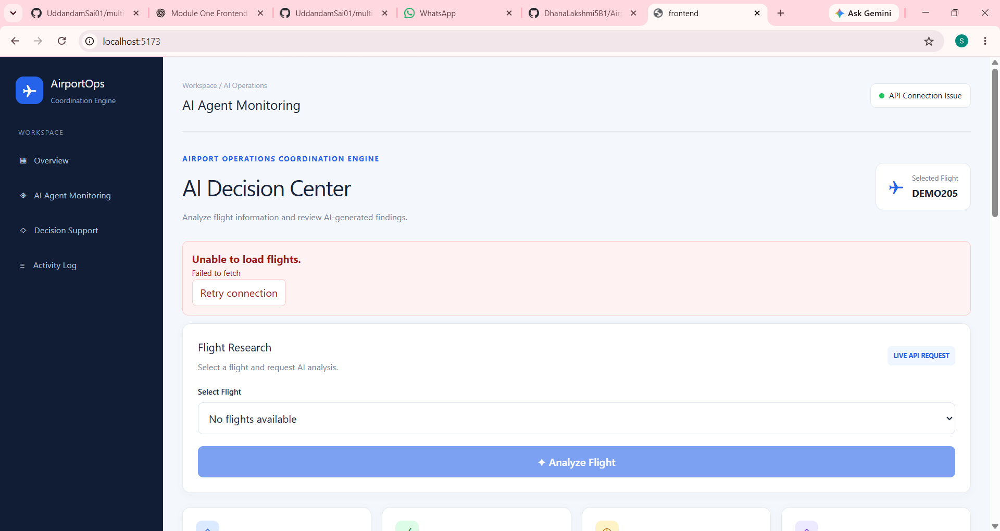
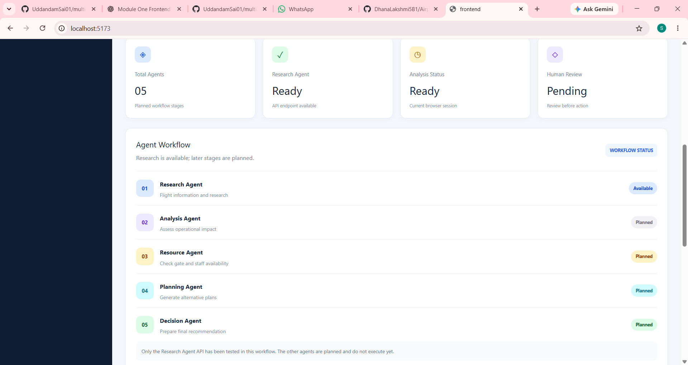
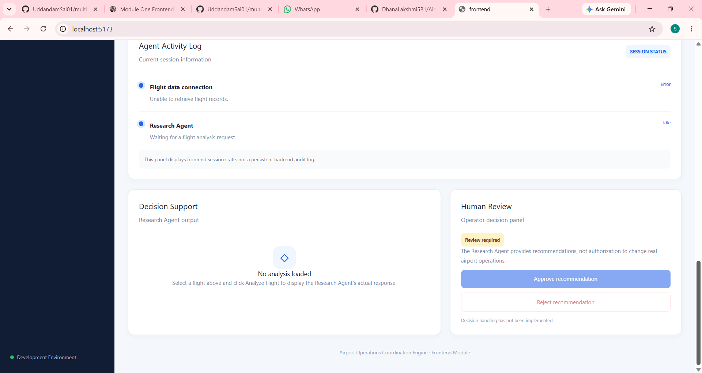
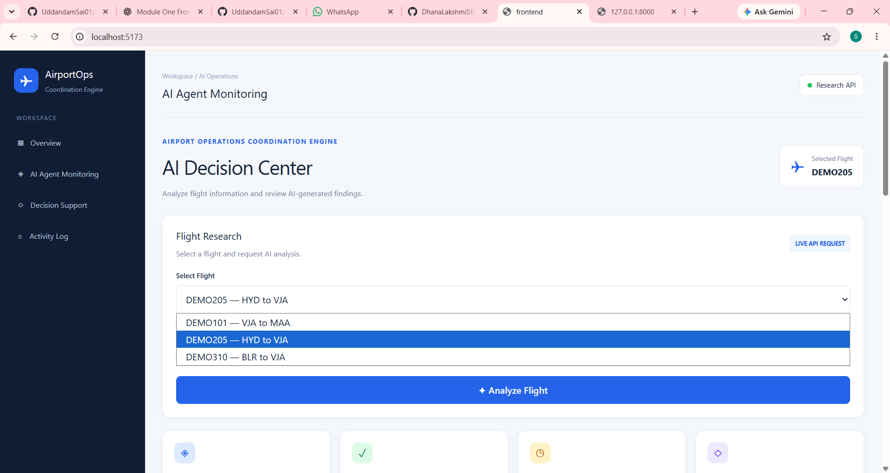
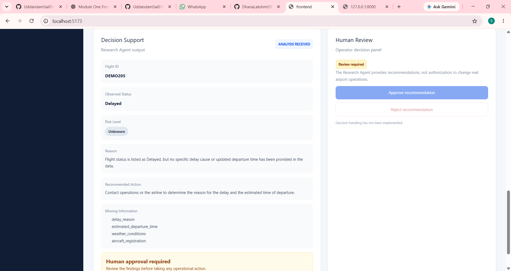

# ✈️ Airport Operations Coordination Engine

### Infosys Springboard Internship 7.0 | Milestone 1

**✈️ – AI Agent Monitoring & Decision Support Dashboard** is a React-based frontend developed as part of the Airport Operations Coordination Engine. It provides an interactive dashboard for selecting flights and viewing flight analysis results, risk assessments, recommended actions, and missing information.

---

## 📌 Project Overview

The frontend provides a user-friendly dashboard for monitoring flight information and presenting analysis results in an organized format. Its interface includes flight selection, agent activity monitoring, decision support, and human review sections.


## 📸 Frontend Screenshots

### 1. Flight Research Without API Data


### 2. AI Agent Workflow Status


### 3. Decision Support & Human Review (Without Data)


### 4. Flight Research with Data


### 5. Decision Support with Data



## 🎯 Objective

To develop a responsive and interactive dashboard that presents flight analysis information clearly and supports airport operations monitoring and decision-making.

## ✨ Key Features

- ✈️ **Flight Selection** – Select a flight from the available flight records.
- 🤖 **Flight Analysis Display** – View the analysis results for a selected flight.
- ⚠️ **Risk Assessment** – Display the risk level associated with a flight analysis.
- 📋 **Decision Support** – View analysis explanations and recommended actions.
- 🔎 **Missing Information** – Identify information required for further assessment.
- 📊 **Analysis Status** – View the current analysis state, including Ready, Running, Completed, and Error.
- 📝 **Agent Activity Log** – View activity information related to flight data and agent status.
- 👤 **Human Review Section** – Display the interface for reviewing analysis results.
- 📱 **Responsive UI** – Use the dashboard on desktop and smaller screens.
- 🎨 **Modern Dashboard Design** – Navigate a clean, organized interface with a blue-themed layout.

## 🛠️ Technologies Used

- React.js
- JavaScript (ES6+)
- TailwindCSS
- Vite
- npm
- Git and GitHub
- Visual Studio Code

## 📂 Project Structure

```text
frontend/
├── public/
├── src/
│   ├── screenshots/
│   |    ├── Ai-Agent-workflow-Status.png
│   |    ├── Decision-support-&-Human-review-without-data.png
│   |    ├── Decision-Support-with-data.png
│   |    ├── Flight-Research-with-data.png
│   |    └── Flight-Research-without-api-data.png
│   ├── services/
│   │   └── researchApi.js
│   ├── App.jsx
│   ├── App.css
│   ├── index.css
│   └── main.jsx
├── index.html
├── package.json
├── package-lock.json
├── vite.config.js
└── README.md
```

*Note: The folders shown are based on the frontend organization. Keep the structure consistent with the files actually present in your repository.*

## ⚙️ Prerequisites

Before running the project, ensure you have installed:

- Node.js
- npm (included with Node.js)
- Git
- Visual Studio Code or another code editor

## 🚀 Installation and Setup

### Step 1: Clone the Repository

Open a terminal and run:

```bash
git clone YOUR_FRONTEND_GITHUB_REPOSITORY_URL
```

Replace the placeholder with your actual GitHub repository URL.

### Step 2: Navigate to the Project Folder

```bash
cd YOUR_FRONTEND_REPOSITORY
```

Replace `YOUR_FRONTEND_REPOSITORY` with the folder created when cloning the repository.

### Step 3: Install Dependencies

Run the following command inside the project folder:

```bash
npm install
```

This installs the packages required to run the frontend application.

### Step 4: Start the Development Server

```bash
npm run dev
```

### Step 5: Open the Application

Open the local URL displayed in the terminal. The default Vite address is usually:

```text
http://localhost:5173/
```

The frontend dashboard should now be available in your browser.

### Step 6: Build the Project

To create a production build, run:

```bash
npm run build
```

Vite generates the production files in the `dist/` directory.

## 📈 Milestone 1 Outcome

- Developed the frontend dashboard using React and Vite.
- Created a structured interface for flight selection and analysis results.
- Designed dashboard sections for agent monitoring and decision support.
- Implemented the display of risk assessments, explanations, recommended actions, and missing information.
- Added loading, completion, and error status displays.
- Developed a responsive user interface for different screen sizes.
- Verified the frontend production build.

## 🔮 Future Enhancements

- Integrate the ML team's flight delay prediction API when it becomes available.
- Display delay probability and expected delay duration when supported by the backend.
- Integrate rule-engine results into the decision support dashboard.
- Expand agent activity logging with timestamps and detailed workflow events.
- Improve the visual presentation of flight risk assessments.
- Refine the responsive layout and user experience.
- Add further frontend features as the project evolves.

## 👩‍💻 Internship Details

- **Internship Program:** Infosys Springboard Internship 7.0
- **Project Title:** Airport Operations Coordination Engine
- **Module:** AI Agent Monitoring & Decision Support
- **Milestone:** Milestone 1
- **Frontend:** React.js, Vite, JavaScript, TailwindCSS
- **Status:** Frontend prototype developed

---

### Developed as part of Infosys Springboard Internship 7.0

**✈️ Airport Operations Coordination Engine | AI Agent Monitoring & Decision Support**
